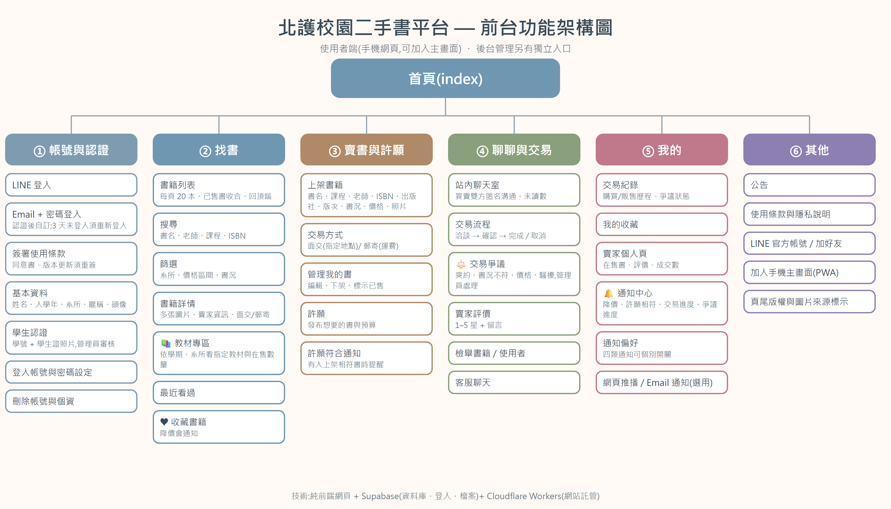

# 文件

- [ERD.md](ERD.md) — 資料庫關聯圖(GitHub 內建 Mermaid 渲染;圖片版 [ERD.png](ERD.png) / [ERD.pdf](ERD.pdf))
- 前台功能架構圖 — [frontend-architecture.png](frontend-architecture.png) / [frontend-architecture.pdf](frontend-architecture.pdf)
- 資料表與安全規則(RLS)原始定義 — [../supabase/](../supabase/)

